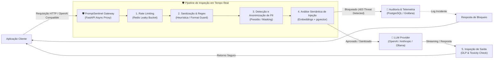

# 🛡️ PromptSentinel (AI Firewall & LLM Security Gateway)

> **Gateway reverso de segurança e firewall de alta performance para inferência em Modelos de Linguagem (LLMs).**  
> Intermediário inteligente e transparente entre aplicações clientes e provedores de IA (OpenAI, Anthropic, Ollama, vLLM).

---

## 🎯 Visão Geral do Projeto

Aplicações modernas integradas a IA generativa enfrentam vetores de ataque inéditos no desenvolvimento de software tradicional. O **PromptSentinel** atua como uma camada defensiva de borda (*Edge / Reverse Proxy*), analisando prompts e payloads antes de atingirem os modelos de linguagem, e inspecionando respostas geradas antes de retornarem ao usuário final.

### 🛑 Problemas Mitigados (OWASP Top 10 for LLMs)
- **LLM01: Prompt Injection** (Direto e indireto / Jailbreaks)
- **LLM02: Sensitive Information Disclosure** (Vazamento de PII, senhas, chaves de API)
- **LLM04: Model Denial of Service** (Consumo excessivo de tokens, ataques de exaustão)
- **LLM06: Excessive Agency / Insecure Output Handling** (Respostas maliciosas com payloads XSS/SQLi)

---

## 🏗️ Arquitetura do Sistema



---

## 💻 Stack Tecnológica

| Componente | Tecnologia | Propósito |
|---|---|---|
| **API Gateway Core** | Python 3.12 + FastAPI (Uvicorn / Asgi) | Baixa latência, proxy assíncrono compatível com a API OpenAI (`/v1/chat/completions`) |
| **Banco de Dados & Vetores** | PostgreSQL 16 + `pgvector` | Armazenamento de logs de auditoria e busca por similaridade semântica (cosseno) de jailbreaks conhecidos |
| **Cache & Limitação** | Redis 7 | Rate limiting distribuído (Token Bucket/Leaky Bucket) e cache de respostas repetidas |
| **Detecção de PII** | Microsoft Presidio / Heurísticas Customizadas | Anonimização e pseudonimização de CPFs, e-mails, números de cartão e credenciais |
| **Embeddings Locais** | FastEmbed / ONNX Runtime (`bge-small-en-v1.5` ou `all-MiniLM-L6-v2`) | Vetorização local ultrarrápida (<10ms) sem depender de APIs externas |
| **Containerização** | Docker & Docker Compose | Inicialização completa e reproduzível com um único comando |
| **Testes & Benchmarks** | Pytest, Locust, HTTPX | Validação de regressão e medição de throughput/latência sob carga |

---

## ⚡ Diferenciais Técnicos para o Portfólio

1. **Proxy Transparente (Drop-in Replacement):**  
   O gateway aceita a especificação padrão da OpenAI. Qualquer aplicação cliente pode apenas trocar a `base_url` para o PromptSentinel sem mudar o SDK.
2. **Classificação Híbrida (Fast-path vs Slow-path):**
   - *Fast-path (<3ms):* Filtros de palavras-chave, regex de alta eficiência e detecção de padrões óbvios.
   - *Slow-path (<25ms):* Embedding semântico e busca vetorial no `pgvector` para detecção de injeções sofisticadas/ofuscadas.
3. **Auditoria Criptografada e Trilha de Conformidade:**  
   Armazenamento de registros de requisições maliciosas com hash seguro para auditoria LGPD/GDPR sem expor o PII original.

---

## 📊 Métricas de Impacto (Para Currículo e LinkedIn)

Exemplos de conquistas mensuráveis a serem destacadas após a implementação dos testes de carga:
- *"Desenvolvimento de gateway reverso assíncrono em Python/FastAPI capaz de processar **+2.000 req/s** com latência adicionada inferior a **18ms** por requisição."*
- *"Implementação de pipeline de segurança com `pgvector` alcançando **98.2% de precisão** no bloqueio de ataques de Jailbreak conhecidos e zero requisições externas para inferência de embeddings."*
- *"Ambiente 100% containerizado com Docker Compose, reduzindo o tempo de setup local para menos de **90 segundos**."*

---

## 🚀 Como Iniciar (Quickstart)

```bash
# 1. Clonar repositório
git clone https://github.com/seu-usuario/prompt-sentinel.git
cd prompt-sentinel

# 2. Configurar variáveis de ambiente
cp .env.example .env

# 3. Subir todos os serviços (API, Postgres com pgvector, Redis)
docker compose up -d --build

# 4. Executar bateria de testes de ataque
pytest tests/
```
