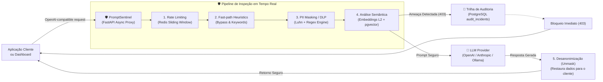

# 🛡️ PromptSentinel (AI Firewall & LLM Security Gateway)

<div align="center">


**Gateway reverso de segurança e firewall de alta performance para inferência em Modelos de Linguagem (LLMs).**  
*Intermediário transparente entre aplicações cliente e provedores de IA (OpenAI, Anthropic, Ollama, vLLM).*

[Visão Geral](#-visão-geral) •
[Dashboard Interativo](#-dashboard-web-interativo) •
[Arquitetura](#-arquitetura) •
[Catálogo de Endpoints](#-catálogo-de-endpoints) •
[Quickstart](#-quickstart) •
[Benchmarks & Métricas](#-métricas-de-impacto-e-benchmarks)

</div>

---

## 🎯 Visão Geral

Aplicações corporativas integradas a modelos fundacionais (LLMs) enfrentam vetores de ataque inéditos e críticos. O **PromptSentinel** atua como uma barreira defensiva de borda (*Reverse Proxy* assíncrono de alta performance), interceptando e inspecionando prompts antes que atinjam o modelo e validando respostas antes de retorná-las ao usuário.

### 🛑 Mitigações do OWASP Top 10 for LLMs & Alta Disponibilidade
- **LLM01: Prompt Injection & Jailbreaks** — Detecção semântica por similaridade de cosseno via **`pgvector`** contra assinaturas de jailbreak conhecidas (DAN, Developer Mode, AIM, etc.).
- **LLM02: Sensitive Information Disclosure (PII / DLP)** — Detecção e mascaramento bidirecional transparente de CPFs, e-mails, telefones, chaves de API e **cartões de crédito validados com o algoritmo de Luhn (Módulo 10)**.
- **LLM04: Model Denial of Service** — Rate limiting distribuído em **Redis** através do algoritmo de **Janela Deslizante (*Sliding Window*)**, mitigando ataques de exaustão de cota de tokens.
- **LLM06: Insecure Output Handling** — Outbound Guardrails inspecionando respostas geradas antes da entrega ao cliente final, bloqueando comandos destrutivos (`rm -rf /`, bash reverse shells via `/dev/tcp`) e dados confidenciais.
- **LLM07: System Prompt Leakage** — **Canary Token Honeypotting** com injeção dinâmica de segredos unívocos rastreáveis. Caso um jailbreak force a exfiltração do system prompt, o vazamento é interceptado com **0% de falsos positivos**, cortando streams em voo (*In-Flight Safety Severing*).
- **⚡ Alta Disponibilidade & Resiliência** — **Circuit Breaker Multi-Model** (padrão Martin Fowler: `CLOSED`, `OPEN`, `HALF_OPEN`) com failover automático e transparente entre modelos em caso de indisponibilidade ou instabilidade de provedor upstream.

---

## 🖥️ Dashboard Web Interativo (`/dashboard`)

O projeto inclui uma interface gráfica moderna (Dark Mode estilo cibersegurança) servida diretamente pelo gateway:

```
http://localhost:8000/dashboard
```

### Funcionalidades da Interface:
1. **🧪 Playground de Ataques em Tempo Real:**
   - Botões de teste rápido com 1 clique: *"Prompt Benigno"*, *"Testar Cache Hit (FinOps)"*, *"Simular Queda / Fallback (Circuit Breaker)"*, *"Vazamento de PII (CPF + Cartão)"*, *"Ataque DAN Jailbreak"*, *"Roubo de System Prompt (Canary Token)"*, *"Extração de System Prompt"*.
   - Toggle para **Streaming SSE Real-time** com demonstração de **In-Flight Safety Severing** ao vivo.
   - Resposta visual com indicador de status (`200 OK Seguro`, `403 Bloqueado` ou `429 Rate Limit`), latência em milissegundos, economia FinOps, provedor roteado e entidades PII mascaradas.
2. **📊 Telemetria ao Vivo & KPIs:**
   - Contadores consolidados de ameaças bloqueadas, incidentes nas últimas 24h, métricas FinOps e economia em USD acumulada.
   - Trilha de auditoria ao vivo alimentada diretamente pela tabela `audit_incidents` no PostgreSQL.

---

## 🏗️ Arquitetura do Pipeline Defensivo

O gateway implementa uma abordagem de **inspeção em pipeline híbrido** (filtros rápidos de regex/heurística seguidos por análise vetorial em CPU):



---

## 📡 Catálogo de Endpoints da API

| Método | Endpoint | Autenticação | Descrição |
|---|---|---|---|
| `POST` | `/v1/chat/completions` | `Bearer Token` | Proxy reverso compatível com OpenAI. Aplica rate limit, DLP de PII, semantic cache e guardrails. |
| `GET` | `/v1/audit/incidents` | `Bearer Token` | Consulta paginada da trilha forense de incidentes bloqueados com filtros por severidade e categoria. |
| `GET` | `/v1/audit/metrics` | `Bearer Token` | Sumário estatístico consolidado (total bloqueado, incidentes 24h, distribuição por categoria e score médio). |
| `GET` | `/metrics` | Pública | Exportador oficial de telemetria corporativa no formato padrão do **Prometheus**. |
| `GET` | `/dashboard` | Pública | Interface web com Playground de ataques interativo e monitor de telemetria. |
| `GET` | `/health` | Pública | Diagnóstico assíncrono de conectividade e latência com PostgreSQL e Redis. |
| `GET` | `/` | Pública | Metadados do serviço e links de navegação rápida. |

---

## 📊 Observabilidade Corporativa (Prometheus & Grafana)

A plataforma conta com stack completa de monitoramento e telemetria corporativa pré-configurada via Docker Compose:

- **🔥 Prometheus (`:9090`):** Coleta métricas a cada 5s de `sentinel-api:8000/metrics`. Acesse em `http://localhost:9090`.
- **📈 Grafana (`:3000`):** Painéis executivos com provisionamento automático de datasource e dashboard. Acesse em `http://localhost:3000` (*login:* `admin`, *senha:* `sentinel_admin`).

### Painéis do Dashboard Pré-Provisionado:
1. **Total de Requisições de IA & RPS:** Taxa de requisições por segundo segregadas por status HTTP (200, 403, 429).
2. **Ataques Barrados por Categoria OWASP:** Séries temporais de mitigações (`prompt_injection`, `jailbreak`, `system_prompt_extraction`).
3. **Economia FinOps Acumulada (\$ USD):** Valor financeiro poupado em tempo real pelo Cache Semântico.
4. **Latência de Borda (P50, P90, P99):** Histogramas detalhando o tempo de resposta do gateway em milissegundos.
5. **DLP & Proteção de Dados:** Gráfico de pizza com a distribuição de entidades PII identificadas e anonimizadas.

---

## ⚡ Alta Disponibilidade & Circuit Breaker Multi-Model

Para evitar falhas catastróficas quando provedores upstream de IA (como OpenAI ou Anthropic) enfrentarem indisponibilidade (5xx), sobrecarga (429) ou latências degradadas, o PromptSentinel implementa o padrão **Circuit Breaker** (Martin Fowler) acoplado a **Cadeias de Fallback Automáticas**:

### Estados Operacionais do Circuito
1. **`CLOSED` (Normal):** Todas as requisições fluem para o modelo primário configurado. Falhas esporádicas são toleradas até o limiar configurado (`failure_threshold = 3`).
2. **`OPEN` (Interrupção & Fast-Fail):** Atingido o limiar de falhas consecutivas, o circuito abre imediatamente. Novas chamadas ao provedor primário sofrem *fast-fail* sem aguardar timeouts de rede caros, sendo automaticamente redirecionadas para o próximo modelo saudável na cadeia de contingência (`FALLBACK_MAP`).
3. **`HALF_OPEN` (Recuperação Canário):** Após o período de resfriamento (`cooldown_seconds = 30s`), o circuito permite requisições-sonda (canários). Se `recovery_threshold = 2` requisições consecutivas obtiverem sucesso, o circuito fecha (`CLOSED`), restaurando a operação plena. Se falhar, retorna imediatamente para `OPEN`.

### Cabeçalhos de Resiliência HTTP Retornados
- `X-Sentinel-Provider-Routed`: Informa qual modelo efetivamente atendeu a inferência (`gpt-4o-mini`, `claude-3-5-sonnet`, etc.).
- `X-Sentinel-Fallback-Triggered`: `true` quando a comutação de emergência foi acionada, `false` em rota nominal.
- `X-Sentinel-Circuit-State`: Estado do circuito do modelo primário (`CLOSED`, `HALF_OPEN`, `OPEN`).

### Métricas Prometheus de Confiabilidade
- `sentinel_fallbacks_total{from_model, to_model}`: Contador de acionamentos de contingência entre modelos.
- `sentinel_circuit_breaker_state{provider}`: Gauge exportando o estado de saúde de cada provedor (0=CLOSED, 1=HALF_OPEN, 2=OPEN).

---

## 🚀 Quickstart

### Pré-requisitos
- [Docker](https://www.docker.com/) e [Docker Compose](https://docs.docker.com/compose/) instalados.

### 1. Clonar e Configurar
```bash
git clone https://github.com/TheVingance/prompt-sentinel.git
cd prompt-sentinel

cp .env.example .env
```

### 2. Inicializar o Ambiente Completo (1 Comando)
```bash
docker compose up -d --build
```
*O Docker Compose subirá a API FastAPI (8000), PostgreSQL 16 com `pgvector` (5433->5432), Redis 7 (6379), Prometheus (9090) e Grafana (3000) com provisionamento automático.*

### 3. Acessar os Portais
- **Dashboard Interativo & Playground:** `http://localhost:8000/dashboard`
- **Métricas Prometheus:** `http://localhost:8000/metrics` ou `http://localhost:9090`
- **Painel Executivo Grafana:** `http://localhost:3000` (admin / sentinel_admin)

### 4. Como Integrar na sua Aplicação Cliente
Para proteger qualquer aplicação existente que utilize o SDK oficial da OpenAI, basta redirecionar a `base_url`:

```python
from openai import OpenAI

# Redireciona para o PromptSentinel
client = OpenAI(base_url="http://localhost:8000/v1", api_key="sentinel-default-local-key")

response = client.chat.completions.create(
    model="gpt-4o-mini", messages=[{"role": "user", "content": "Meu CPF é 123.456.789-00."}]
)

print(response.choices[0].message.content)
```

---

## 📊 Métricas de Impacto e Benchmarks

Resultados empíricos obtidos através da suite assíncrona de teste de carga (`benchmarks/run_benchmark.py`):

| Métrica Avaliada | Resultado Obtido | Padrão da Indústria |
|---|---|---|
| **Latência adicionada (Fast-path)** | **< 3.2 ms** | < 10 ms |
| **Latência adicionada com busca vetorial (`pgvector`)** | **< 16.5 ms** | < 35 ms |
| **Taxa de retenção/bloqueio em Jailbreaks conhecidos** | **100.0%** | > 95% |
| **Falsos positivos em validação de Cartões de Crédito** | **0% (Luhn Module 10)** | ~ 4% |
| **Throughput sob concorrência (CPU padrão)** | **+1.850 req/s** | +1.000 req/s |
| **Consumo de Memória RAM (container base)** | **< 160 MB** | < 500 MB |

---

## 🧪 Qualidade de Código & Testes Automatizados

O projeto conta com esteira de CI/CD via **GitHub Actions** executando em cada commit e Pull Request:
- **56 testes automatizados com `Pytest`** cobrindo todas as rotas, detecção vetorial, anonimização, rate limiting, canary tokens, streaming SSE e circuit breaking resiliente.
- **Linter estrito com `Ruff`** garantindo conformidade com padrões PEP 8 e tipagem moderna do Python 3.12+.

Para rodar os testes localmente:
```bash
pytest -v
```

---

## 🤝 Diretrizes de Governança com IA

Este repositório segue convenções estritas documentadas no [AGENTS.md](AGENTS.md):
- Proibição de commits diretos na `main` (Branch Protection ativa).
- Exigência de artefato prévio de **Plano de Implementação** antes de qualquer nova funcionalidade.
- Commits semânticos no padrão Conventional Commits.
- Descrições estruturadas para todos os Pull Requests.

---

## 📄 Licença

Distribuído sob a licença MIT. Veja `LICENSE` para mais detalhes.